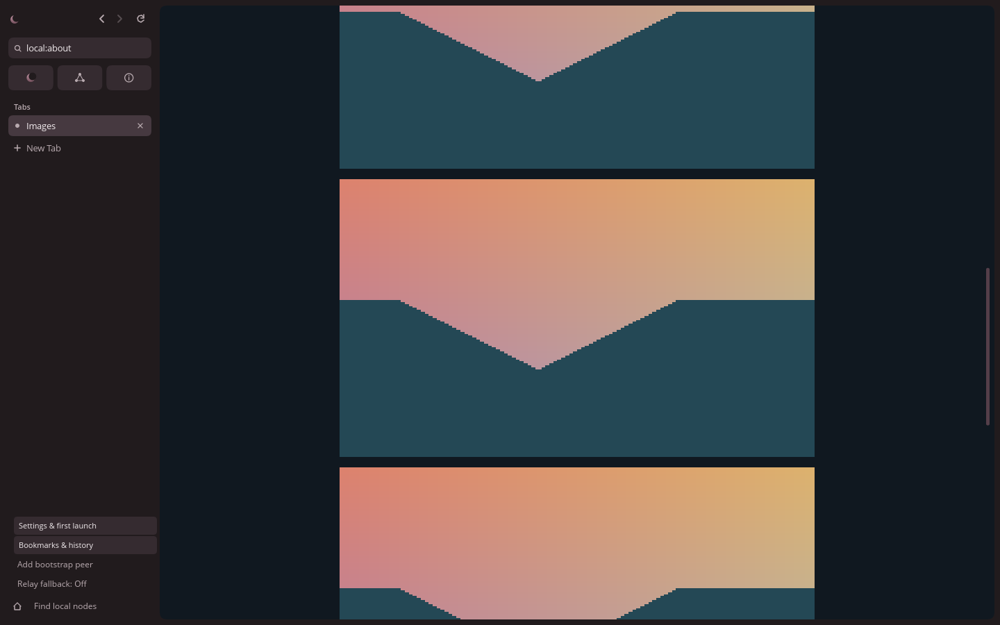

<div align="center">

# 🌌 YamiNet

**A different kind of web. Made for people, not platforms.**

Explore independent websites. Share your own corner of the internet. Stay in control.

**Experimental alpha** · **Windows & Linux** · **[Free and open source](LICENSE)**

[Get started](#-get-started) · [Explore YamiNet](#-explore-yaminet) · [Make a website](#-create-your-own-website) · [How it works](#-what-is-yaminet) · [Help](#-need-help)



*Yami Browser renders YLang pages and images in its own native window—no Chromium, WebView or web engine.*

</div>

---

## ✨ What is YamiNet?

YamiNet is an **experimental alternative web** where people can create and visit websites hosted by independent computers instead of relying on one big platform.

You browse it with **Yami Browser**, a desktop application built specifically for YamiNet. Websites have their own `yami://` addresses, and you can discover pages shared by other people.

| **Discover** | **Browse** | **Keep your favorites** |
| :--- | :--- | :--- |
| Explore saved website directories and search downloaded page indexes. | Read native pages with images, links and multiple tabs. | Save bookmarks and choose whether optional local history is kept—off by default. |

**No YamiNet account required. No built-in ads or telemetry.** You choose when to connect to other computers. YamiNet is still young, so finding websites currently takes a little setup—see below.

> [!IMPORTANT]
> **YamiNet is an early experiment, not a secure anonymity network.** The apps are unsigned, public-network testing is incomplete, and connections can reveal network metadata. Don't use it for sensitive activity. [Read the security notes](SECURITY.md).

## 🚀 Get started

You don't need to know Rust or install programming tools to use a **prebuilt desktop package**.

### 1. Get Yami Browser

**There is no published GitHub release yet.** For testing, open the [build history](https://github.com/ItsKorayYT/YamiNet/actions/workflows/alpha.yml?query=branch%3Amain), choose the latest **successful** run from `main`, and scroll to **Artifacts** at the bottom of the run page. GitHub may ask you to sign in, and artifacts can expire. These are experimental CI builds, not certified releases.

On GitHub, each artifact downloads as a ZIP, even on Linux.

| Windows 10/11 (64-bit) | Linux (64-bit, X11/XWayland) |
| :--- | :--- |
| Download **YamiNet-alpha-Windows** and extract the artifact ZIP.<br><br>Then either run the included per-user `YamiNet-<version>-windows-x86_64-setup.exe` installer, or extract the portable `YamiNet-<version>-windows-x86_64.zip` and open **Launch Browser.cmd** (or `yami-browser.exe`). | Download **YamiNet-alpha-Linux** and extract the artifact ZIP.<br><br>Then extract `YamiNet-<version>-linux-x86_64.tar.gz`, keep the folder together, and run `./launch-browser.sh` from it. |

Each package archive and installer has a matching `.sha256` file. Compare the hash before running anything; the [installation guide](docs/installation.md) has copy-paste commands. The packages are **not code-signed**. For OS dependencies and data locations, see the same guide.

### 2. Open Yami Browser

The browser opens directly without a welcome popup. **Local only** is enabled by default, so you can explore the built-in **Welcome** and **About** pages without contacting other computers. Open **Settings** in the sidebar to change browsing preferences.

### 3. Try a few things

| Action | Shortcut |
| :--- | :--- |
| Open a new tab | `Ctrl + T` |
| Focus the address bar | `Ctrl + L` |
| Find a word on a page | `Ctrl + F` |
| Bookmark the current page | `Ctrl + D` |
| Go back / forward | `Alt + Left` / `Alt + Right` |

You can find more controls in the [browser guide](docs/desktop-browser.md).

## 🧭 Explore YamiNet

YamiNet sites don't use ordinary `.com` addresses. A typical address looks like this:

```text
yami://yn1-…/home
```

The long identifier tells the browser **which YamiNet site to connect to**, and the final part (`/home`) is the page. The `…` is a placeholder for the site's full public node identity.

**To visit someone else's site today:**

1. Get the site's complete `yami://` address and a trusted *bootstrap peer* pin from the site's operator or another trusted source. A bootstrap pin usually looks like `full-node-ID@IPv4:port`. A bootstrap peer helps your browser locate signed records; it is not proof that a site is safe.
2. Open **Settings**, enable network browsing, and add the pin with **Add bootstrap peer** in the sidebar.
3. Paste the website's `yami://` address into the address bar and press Enter.

You can also open a direct `ynps://` link when a site operator gives you one. Always confirm shared identities through a trusted channel. YamiNet does not ship a verified public directory or connect to public peers automatically.

### Find sites with Discover

Discover is an early preview feature. Choose **Discover** in the sidebar:

| Mode | What it does |
| :--- | :--- |
| **Websites** | Search website directory listings you've already saved. Under **Directories**, add a subscription; nothing is fetched until you choose **Refresh selected directory**. |
| **Pages** | Search page indexes you've downloaded. Under **Search providers**, add an independent provider; refresh is always explicit. |

Search queries run on your computer, and there is no central search server. Refreshing a source loads its data; your search terms stay local. Adding a source does not download anything until you refresh it.

**Results are untrusted hints, not endorsements.** Opening a result still verifies the destination website's identity.

[Learn more about Discover](docs/discover.md) · [Full-text search guide](docs/fulltext-search.md)

## 🎮 Play browser games

Choose **Open local game** in the browser sidebar and enter the full path to
`games/breakout/game.yami-game.json` in the package. **Prism Breakout** opens in
its own native tab. Use **Space** to start and launch the ball, **A/D** or the
arrow keys to move, and **P** to pause or resume.

Hosted games now offer an explicit **Play game** link on authenticated YamiNet
websites. Choose Play to fetch and run the game inside a browser tab, with no
installation or manual game-file handling. Ordinary page loads never launch code.
Publishers can host their own manifests and Wasm modules; see [Games 0.2](docs/games-0.2.md)
for publishing, the two-process demonstration and testing limits. Local games
continue to work. The WebAssembly runtime has experimental resource limits,
without WASI or operating-system access.
See the [game walkthrough](games/README.md) and
[ABI, limits and measured performance](docs/games-0.1.md).

## 🎨 Create your own website

You can build a personal page, a blog or a portfolio with YamiNet's included site tools—**no HTML or JavaScript required**.

1. Start from a template: **personal**, **blog**, or **portfolio**.
2. Edit the page text and styling files.
3. Preview it locally before deciding whether to share it.
4. When you're ready, publish it using your own YamiNet node.

Start with the [step-by-step website publishing guide](docs/publishing-sites.md). It covers creating a site, editing its files, previewing, identities and hosting.

To run your own experimental bootstrap/relay test network on a VPS, see the [public test-network deployment guide](docs/public-testnet.md).

<details>
<summary><strong>Already comfortable with a terminal? Try creating a site.</strong></summary>

Open a terminal in the folder where you want to keep your site. Run the included `yami-node` program (on Windows, `yami-node.exe`; it sits beside the browser in the package). If it is not on your PATH, use its full file path:

```sh
yami-node site new my-site personal
yami-node site check my-site
```

To preview and publish, follow the [full guide](docs/publishing-sites.md); it explains how to keep your private identity outside the public website folder.

</details>

## 💜 Why build another web?

The regular web is powerful, but getting online often means depending on a handful of platforms. YamiNet explores another approach:

- **Independent publishing** — people can host their own websites.
- **A dedicated browser** — content is rendered by a native application, not a conventional web engine.
- **User-controlled connections** — no automatic connection to public networks when you open the app.
- **Local search** — search downloaded website directories and page indexes without sending queries to a search server.
- **Room to grow** — richer interactive experiences and stronger privacy protections are future goals, **not current features or guarantees**.

YamiNet is built in Rust with its own document and styling languages, **YLang** and **YSL**. You don't have to learn those technologies to explore the browser.

## ❓ Need help?

| I want to… | Start here |
| :--- | :--- |
| Install or launch the browser | [Installation guide](docs/installation.md) |
| Follow a walkthrough with screenshots | [First steps](docs/getting-started-0.3.1.md) |
| Understand how Discover works | [Website discovery](docs/discover.md) |
| Search downloaded website pages | [Full-text search](docs/fulltext-search.md) |
| Play the included local game | [Prism Breakout](games/README.md) |
| Make and share my own website | [Create and publish websites](docs/publishing-sites.md) |
| Understand privacy and limitations | [Security notes](SECURITY.md) |
| Report a problem or suggest an idea | [GitHub issues](https://github.com/ItsKorayYT/YamiNet/issues) |

<details>
<summary><strong>🛠️ Developer documentation and building from source</strong></summary>

YamiNet is a Rust workspace pinned to Rust 1.90 (see `rust-toolchain.toml`) with rustfmt and Clippy. Install the toolchain first.

```sh
cargo run -p yami-browser
cargo fmt --all -- --check
cargo clippy --workspace --all-targets --locked -- -D warnings
cargo test --workspace --locked
cargo build --workspace --locked
```

- [Project architecture and principles](docs/vision.md)
- [YLang / YSL and website specifications](docs/websites-0.2.md)
- [Discover and website directory format](docs/discover.md)
- [Full-text search guide](docs/fulltext-search.md) and [validation](docs/fulltext-validation.md)
- [Native game ABI and sandbox limits](docs/games-0.1.md)
- [Node, network and relay configuration](docs/configuration.md)
- [Release engineering and packaging](docs/releases.md)
- [0.3.1 validation and remaining manual tests](docs/validation-0.3.1.md)

Current release engineering still requires physical-device and independently connected network validation. Automated tests, including simulated or loopback networking, are **not** a substitute.

</details>

---

<div align="center">

**An independent web starts with people making things.**

[Explore the code](https://github.com/ItsKorayYT/YamiNet) · [Get started](#-get-started) · [Share an idea](https://github.com/ItsKorayYT/YamiNet/issues)

Free and open source under [GPL-3.0-only](LICENSE).

</div>
