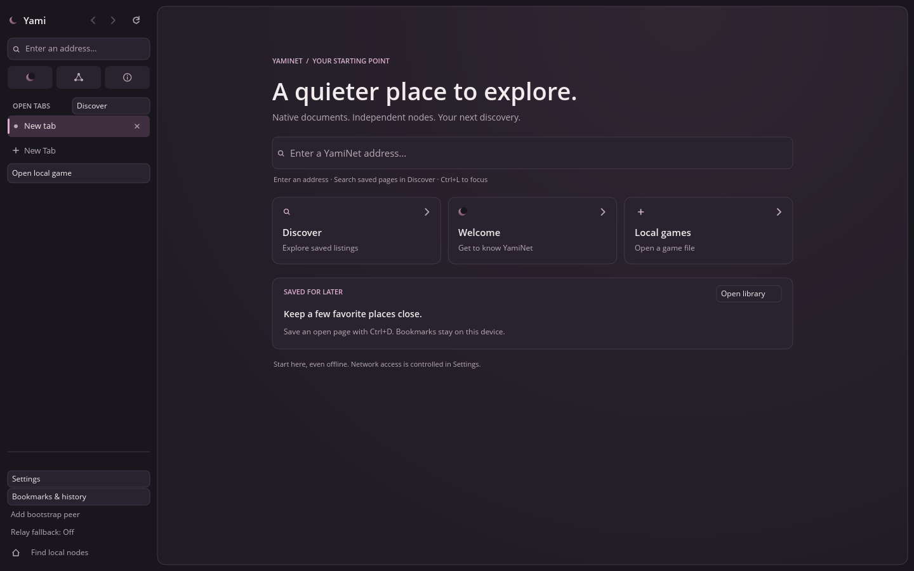
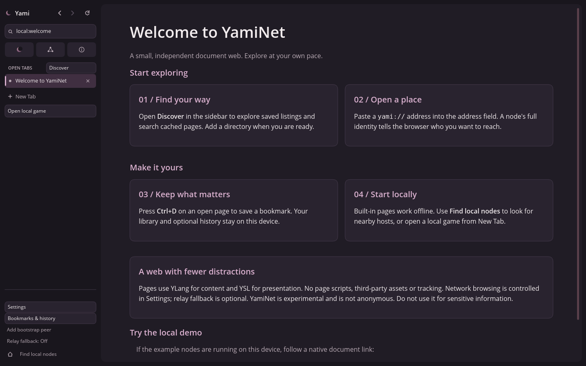
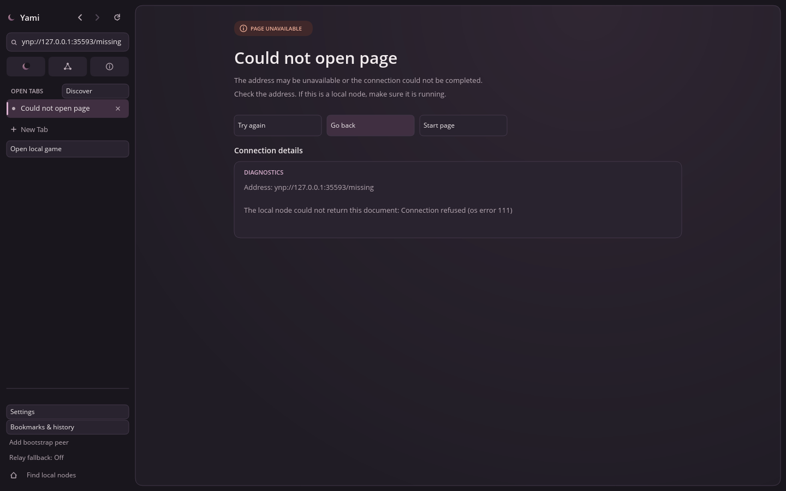

# Native browser UX polish

This change starts from `main` at `fcace92` on `feature/browser-ux-polish`.
It keeps the existing Rust desktop, native document renderer, navigation, local
library and network policies.

## Visual changes

- **New Tab:** a clear YamiNet identity, a working address field sharing the
  existing Unicode editor, Discover/Welcome/local game actions, the first two
  saved bookmarks, and a useful empty library state. Rendering does not fetch
  listings or enable history.
- **Welcome:** a dedicated built-in YLang 0.2 document and YSL sheet, with larger
  type, responsive cards, a short introduction and explicit local demo links.
  Find, scrolling and link handling continue to use the
  existing document renderer. The sample files under `examples/` are unchanged.
- **Errors:** an error badge, explanation, retry/back/start actions and bootstrap
  access for network locations. Full addresses and diagnostics wrap by measured
  font width instead of being cut off at 700 characters. Long details scroll;
  short details use a compact panel. Start recovery always opens the offline
  New Tab, even when a custom homepage is configured.
- **Chrome:** shared charcoal/plum colors, consistent edges and focus styling,
  larger navigation targets, clearer tab selection and aligned utility controls.
  Crowded tabs page around the active tab so all twelve remain reachable without
  covering utilities at the minimum window size, including full verified IDs.

`chrome/pages.rs` holds reusable surfaces, cards, action cards, section labels and
measured diagnostic wrapping. The existing browser button and address controls
are reused. The built-in Welcome sheet follows the same palette while remaining
a normal native document.

## Screenshots

Captured from actual Linux X11 native windows under Xvfb, not browser mockups.
The three main captures are 1440 × 900 at scale 1.

### New Tab



[New Tab at the minimum 900 × 600 window size](images/browser-ux/new-tab-compact.png).

### Welcome



The remaining demo links are reachable by scrolling.

### Error



The error capture uses an unavailable loopback endpoint; it requires no external
service. Its ephemeral port is only a test fixture.

## Validation

Run with the repository's Rust 1.90.0 toolchain:

```sh
cargo fmt -p yami-browser -- --check
cargo clippy -p yami-browser --all-targets --locked -- -D warnings
cargo test -p yami-browser --locked
cargo build -p yami-browser --locked
```

Formatting, strict Clippy, the browser build and all non-ignored browser tests
passed. Automated coverage includes measured Unicode/long-ID wrapping without
truncation, hit-tested start actions and error recovery, diagnostic scrolling,
minimum-size tab paging, complete direct/relayed identity blocks, and chrome
bounds at scale 1 and 2. The existing native document, editor, library, games,
loopback TLS, DHT, relay and rich-site tests also pass.

The extended `--desktop-smoke` passed on a fresh isolated profile and again after
reopening it. It checks real window creation and resize events, native clipboard,
find, tabs, persistence, Discover, a loader connection failure and start-page
recovery, and now writes `new-tab.png`, `welcome.png` and `error.png` beside the
report. For example, with an available X11 display and new writable directories:

```sh
YAMINET_BROWSER_DATA_DIR=/absolute/test-profile \
YAMINET_PEER_DIR=/absolute/test-peers \
yami-browser --desktop-smoke /absolute/captures/first-run.json
```

A separate 900 × 600 native-window check used injected X11 mouse/key events to
focus the page address field, open Welcome, enter an invalid address with Ctrl+L,
and click the error's Start page action. Each resulting title and screenshot was
checked. This is automated X11 input; physical keyboard, IME, Windows, macOS,
Wayland and physical high-DPI displays were not tested. Existing opt-in manual,
multicast and public-endpoint tests retain their ignored status.
