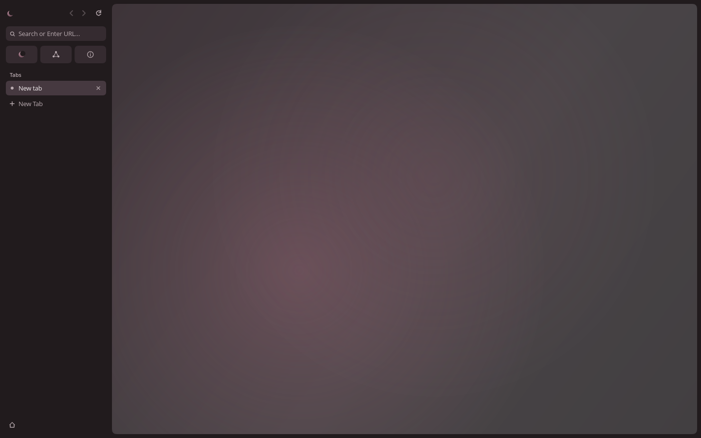
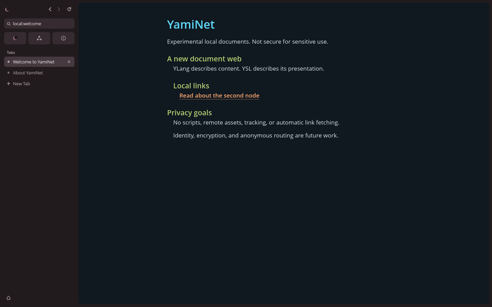

# Yami Browser desktop

Yami Browser opens a native desktop window by default. Its aqua glass chrome,
rounded tabs, sky gradients and original new-tab artwork are drawn in Rust.
The glass reflections are software effects inside an opaque native window;
they do not imply operating-system background blur or transparency. The system
still provides the window title bar and its window controls.

The UI uses `winit` for windows and input, `softbuffer` for presentation,
`tiny-skia` for antialiased graphics, and `cosmic-text` for shaped, antialiased
text. A bundled sans-serif font makes basic typography available without an
Internet font download. No Chromium, WebView, HTML, CSS or JavaScript is involved.
The original YLang, YSL and YNP architecture remains intact.

**Experimental: not secure for sensitive use.** `ynp://` is plaintext,
unauthenticated and limited to numeric loopback addresses. `ynps://` addresses
use TLS 1.3 to the node ID named in the address and may point at a numeric
loopback, private IPv4 LAN or known public IPv4 address. Opt-in LAN discovery is available through
**Find local nodes** in the sidebar; select a private interface, search, inspect
the full untrusted ID, and explicitly open its `ynps://` homepage. The existing
TLS connection must prove that ID before requesting the page. Discovery never
opens sites automatically or saves trust. There is no anonymity, HTTP support
or DNS resolution. See [the security notes](../SECURITY.md) and
[Windows discovery/firewall testing](discovery-testing.md).

## Launch on Windows

Use Windows 10 or Windows 11 with a native desktop session. These are build
instructions, not a claim that the application has been tested on Windows.

1. Install Git for Windows and Rust using the official Rust installer at
   <https://rustup.rs/>. Choose the default MSVC host toolchain.
2. Install Visual Studio Build Tools with **Desktop development with C++**,
   including the MSVC compiler tools and Windows SDK. Rust needs the native
   Microsoft linker when building this application.
3. Open a new PowerShell window after installation, then run:

```powershell
git clone https://github.com/ItsKorayYT/YamiNet.git
cd YamiNet
rustup toolchain install 1.90.0 --profile minimal --component rustfmt --component clippy
cargo run --release -p yami-browser
```

The repository pins Rust 1.90.0. Cargo downloads the native Rust dependencies
on the first build. Subsequent builds can use `--offline` once those dependencies
have been cached. No browser engine or JavaScript tooling needs to be installed.

After a release build, the executable can also be launched directly:

```powershell
.\target\release\yami-browser.exe
```

The initial page works without a node process. Choose the built-in Welcome or
About shortcut to read a real YLang document locally. The address bar understands
`local:welcome` and `local:about`; these are explicit built-in page identifiers,
not a new network protocol. The new-tab page is an internal UI page.

## Read documents over YNP

Open two more PowerShell windows in the repository directory. Start one sample
node in each, leaving both running:

```powershell
cargo run --release -p yami-node -- serve 127.0.0.1:7301 welcome examples/welcome.ylang examples/default.ysl
```

```powershell
cargo run --release -p yami-node -- serve 127.0.0.1:7302 about examples/about.ylang examples/default.ysl
```

In the desktop address bar, enter `ynp://127.0.0.1:7301/welcome` and press Enter.
The document's link opens `ynp://127.0.0.1:7302/about`. The homepage's sample-node
bookmarks also require these node processes; they show an error if no node is
listening. They do not pretend to be a public search or cloud service.

A desktop window can start directly at a YNP address:

```powershell
cargo run --release -p yami-browser -- --desktop ynp://127.0.0.1:7301/welcome
```

For two multi-page sites with links between them, run
`cargo run --release -p yami-node -- serve-dir 127.0.0.1:7301 sites/alice` and
`cargo run --release -p yami-node -- serve-dir 127.0.0.1:7302 sites/bob`
instead, then open `ynp://127.0.0.1:7301/home`. See
[Creating and publishing a YamiNet site](publishing-sites.md).

### Native identity addresses (`yami://`)

Enter `yami://<full-yn1-node-id>/home` without a server endpoint. The existing
DHT supplies signed locations; the browser then verifies the exact requested ID
over TLS 1.3 before fetching. Omitting the document key selects `home`.
There are no bundled bootstrap peers or aliases. Configure ordinary peers using
the existing peer store; see [native addressing](native-addressing.md) for
public/local settings, persistent state, links, tests and current security limits.
Native lookup runs in the existing background loader and retains the native URL
in history and the address bar. No browser private key is required.

### Verified nodes (`ynps://`)

Enter an address such as `ynps://yn1-...@192.168.1.50:7443/home`, as printed
by `yami-node serve-dir ... --tls` (add `--lan` for another computer on the
LAN). While connecting, the page area shows `Verifying node identity…`. The
page is requested only after the node proved exactly that node ID. Under the
address field the sidebar then shows a padlock, **Verified node · TLS 1.3**
and the full node ID; compare it with the ID the node printed. Plaintext
`ynp://` pages show **Not encrypted · not verified** instead.

Links on a verified page that name the node's own address and port open as
`ynps://` with the same node ID. If the node at the address has another
identity, the page shows `Authentication failed at <address>: ...` with both
IDs, and nothing is requested from it. Reload verifies the node again. See
[LAN testing](lan-testing.md) for two Windows computers.

Known remote nodes use the same address field, tabs, renderer, errors and
verification path: enter `ynps://<known-node-id>@<public-IPv4>:<port>/home`.
The remote node must explicitly use `--tls --public`; see
[VPS/forwarded-node testing](internet-testing.md). There is no DNS, automatic
public discovery or replacement of a configured pin. Manual bootstrap peers
can be managed through `yami-node peer`; browser navigation never imports
advertised peers into that list.

Stop each sample node with Ctrl-C in its terminal. Keep the plaintext sample
nodes local; remote experiments require the separate public TLS mode.
All peer application messages, including missing-document replies, use the existing binary YNP
protocol.

## Tabs, navigation and scrolling

The desktop browser has a new-tab button, close buttons, an editable address
bar, Back, Forward and Reload. Each tab keeps separate history and scroll state.
Opening another page after going Back discards the old forward branch. At most
12 tabs can be open. Closing the final tab leaves a fresh new-tab page.

YLang hyperlinks are clickable. Documents are laid out by the native extension
of `yami-render`, using the typed YLang AST and the document's YSL presentation.
The browser theme controls chrome and the new-tab page; it does not replace a
document's YSL. Bundled YSL arrives with a fetched document in the same YNP
response. Links do not fetch anything until explicitly activated.

Use the mouse wheel or the scrollbar to move through a long document. Resizing
reflows the document to the available viewport; window scale changes update
the framebuffer and text rendering for high-DPI displays.

| Shortcut | Action |
| --- | --- |
| Ctrl+L | Focus the address bar |
| Enter | Open the entered address |
| Ctrl+T | Open a new tab |
| Ctrl+W | Close the active tab |
| Ctrl+Tab | Select the next tab |
| Alt+Left / Alt+Right | Back / Forward |
| Ctrl+R | Reload the current page |
| Ctrl+A / Ctrl+C / Ctrl+V | Select all, copy or paste in the focused address field |
| Escape | Leave address editing |

Loading and failure states are visible in the active tab. Network access and
source parsing run on two background workers with bounded pending work.
Completions carry the stable tab ID and navigation generation; a completion
from an older navigation or a closed tab cannot overwrite the current page.
Discarding a stale result does not guarantee that the underlying socket request
was cancelled. Existing YNP per-operation timeouts still apply.

## Linux and headless tools

The Linux desktop build uses X11, including XWayland in a Wayland session.
A native Wayland backend is not enabled. A working graphical display is required
to open the window. No GPU or web engine is required for the software rendering
path.

The terminal and original PPM renderer remain available for debugging and
regression checks. A positional file or YNP URL retains the original terminal
behavior; `--desktop` explicitly chooses a window for an initial URL:

```sh
cargo run -p yami-browser -- --terminal
cargo run -p yami-browser -- examples/welcome.ylang --style examples/default.ysl
cargo run -p yami-browser -- ynp://127.0.0.1:7301/welcome
cargo run -p yami-browser -- examples/welcome.ylang --ppm /tmp/yami.ppm
```

The PPM backend intentionally keeps its original tiny bitmap font. It is a
regression and debugging output, not a screenshot of the desktop interface.

## Native window captures

These 1440×900 images are rendered offscreen by the same paint code the window
uses. Regenerate them with
`cargo test -p yami-browser capture_screenshots -- --ignored`, which writes to
`target/screenshots/`. They are documentation only; the application paints its
own interface and does not use these captures as assets.





## Validation and current limits

From the repository root:

```sh
cargo fmt --all -- --check
cargo clippy --workspace --all-targets -- -D warnings
cargo test --workspace --locked
cargo build --workspace --locked
```

Tests that bind loopback sockets need permission to do so. A successful build
is not visual validation: launch the actual window and inspect it at normal
and high-DPI scale, resize it, open multiple tabs, navigate between the two sample
nodes, click a document link, and test scrolling and error recovery.

This is a local document browser, not a conventional public web browser. There
is no search service, weather service, account system, cloud connection,
extension system, download manager or automated remote content loading. The
homepage's scenic elements are decoration. Bookmarks are bundled sample
shortcuts, not a synchronized account feature. There is no document editing,
complete accessibility tree or production network hardening.

### Current cloud validation status

The native dependencies are resolved in `Cargo.lock`. The complete workspace
build and Clippy with warnings denied pass, and 38 tests pass. Tests cover the
navigation model, tab/history behavior, stale-response rejection, input and
resource bounds, small-window hitboxes, native link geometry, clipped raster
output and high-DPI layout, alongside the preserved parser, YNP and terminal/PPM
regression checks.

A real Linux native window was launched under Xvfb. The rendered homepage and
YLang document viewport were visually inspected. Interaction checks passed for
Back, Forward, Reload, opening and switching tabs, built-in document navigation,
localhost YNP retrieval and an error state. This is actual window validation,
in addition to the offscreen homepage inspections at 1180×800 and 720×540.

Further release-window checks passed for mouse-wheel scrolling, minimum-size
resizing, document hyperlinks, toolbar buttons and tab closing. A controlled
YNP peer delayed its reply while the UI opened another tab and navigated to a
new page; the eventual obsolete reply did not replace that page. Reload also
recovered successfully after a previously unavailable sample node was started.

The actual native window was tested with simulated 200% scaling: the framebuffer
size, shortcut hitboxes, Home control and minimum logical resize were verified.
This does not replace testing on physical high-DPI hardware. Windows runtime
behavior has not been tested; the Windows commands above remain launch
instructions rather than Windows validation evidence.
