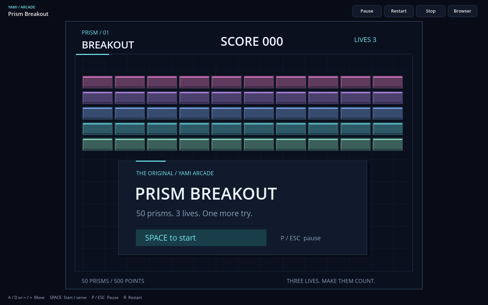
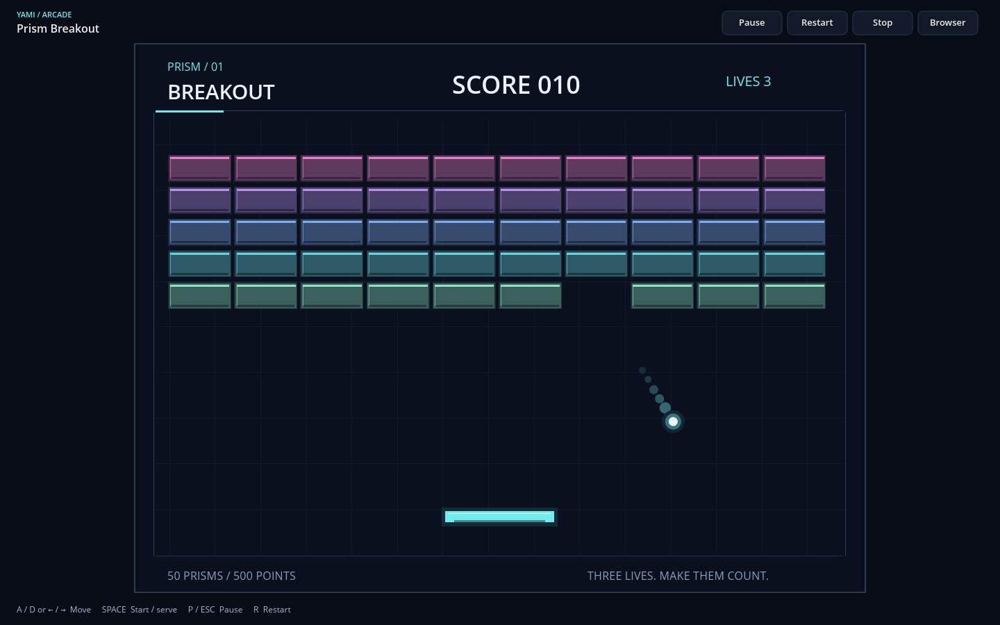
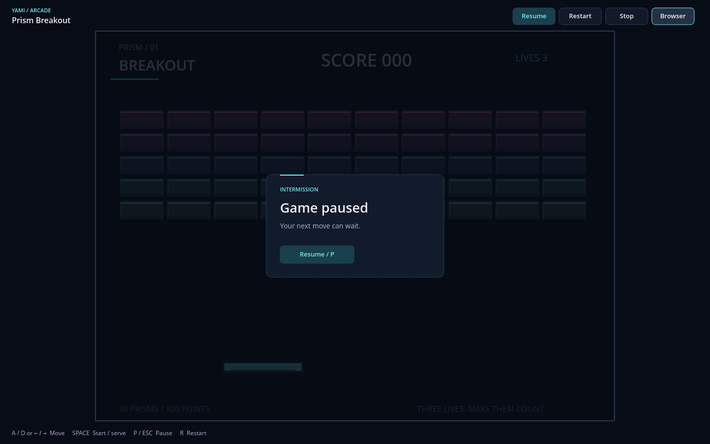
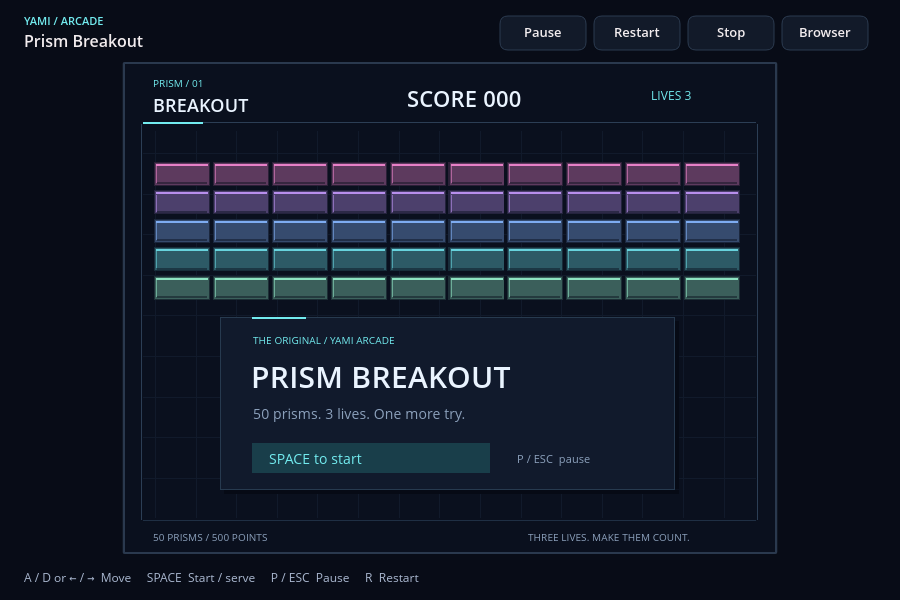

# Yami Games 0.1.1 — native arcade polish

Prism Breakout now opens in a dedicated arcade surface inside Yami Browser.
The sidebar and document controls give way to a compact Pause/Resume, Restart,
Stop and Browser toolbar. Browser pauses the game and restores the sidebar;
Focus game returns to the arcade surface, with explicit resume. Browser
shortcuts and document tabs retain their existing behavior. Opening an address
or browser panel restores normal chrome and releases game input. Tab pauses,
releases movement and focuses toolbar controls; Enter activates the focused
control. Stop frees the VM, while Restart reloads a stopped or failed session.

## Presentation

The centered 4:3 game surface uses the window's available height with narrow
framing and dark letterboxing. Its logical coordinates remain 640×480. At
1440×900 the focused surface is approximately 1051×788, compared with the
previous approximately 979×734 document surface; at 900×600 it grows from
approximately 579×434 to 651×488. The sidebar is still available on demand.

Validated commands now rasterize directly into an isolated pixmap at the
surface's physical display resolution, with one uniform transform. Text is
shaped and antialiased at its final size using bundled Open Sans; sizes 18 and
above use the bundled semibold face for stronger title and HUD hierarchy.
There is no enlargement of a 640×480 glyph bitmap. Fractional DPI scaling uses
physical-pixel surface origins and snaps straight rectangle edges to physical
pixels while keeping glyphs and curves antialiased. All guest drawing, including long text,
remains clipped to this separate surface. The reusable pixmap reallocates only
on size changes; unchanged frames reuse their rasterization.

The game artwork stays in the Rust guest: a restrained cyan, magenta and pastel
spectrum, inset illuminated bricks, quiet background grid, layered ball and
paddle, short ball trail, paddle impact flash and eight bounded fragment slots.
The score and lives follow a consistent header grid. Start, serve, game-over
and victory screens use shared spacing, clear hierarchy and keyboard action
hints. The native pause, loading, stopped and failure cards separate session
state from gameplay and offer an explicit native action button. Controls have
hover, keyboard-focus and disabled treatments. Local performance counters are
available with F3, leaving the ordinary footer for control hints.

All original gameplay rules remain: 50 bricks, 10 points per brick, three lives,
the same paddle and ball movement, collision substeps and serve/restart flow.
The Wasmi backend, ABI 1, fuel, memory, drawing, text and worker limits remain
unchanged. No extra guest imports, capabilities, remote downloads, web engine,
network access or assets were added. Other games use the same native toolbar,
scaling and session cards without browser-side game-specific logic.

## Validation

Checks ran on Linux x86_64 with Rust 1.90.0, an Intel Xeon Platinum 8573C,
three visible CPUs and a two-core cgroup quota. The complete workspace run passed
**333 tests with nine intentional skips**. After the renderer optimizations,
the **15 browser UI tests passed again**, including layout restoration, keyboard
ownership, scaling geometry and clipping at 1×, 1.25×, 1.5× and 2× DPI. Workspace
and guest formatting and Clippy with warnings denied passed. The locked guest
was rebuilt and its matching Wasm binary is checked in.

```sh
cargo fmt --all -- --check
cargo fmt --manifest-path games/breakout/Cargo.toml -- --check
cargo clippy --workspace --all-targets --locked -- -D warnings
cargo clippy --manifest-path games/breakout/Cargo.toml --target wasm32-unknown-unknown --release --locked -- -D warnings
cargo test --workspace --locked
cargo test --locked -p yami-browser --bin yami-browser
cargo build --release --locked -p yami-browser
cargo run --release --locked -p yami-games --example measure -- games/breakout/game.yami-game.json
cargo test --release --locked -p yami-browser --bin yami-browser measure_native_game_rendering -- --ignored --nocapture
# With an available X11 display, xdotool and ImageMagick import:
python3 scripts/test-games-x11.py --browser target/release/yami-browser --output work/game-x11
```

The release native-window script passed immersive launch, Browser/Focus game,
explicit resume, keyboard play, byte-identical paused frames, document shortcuts,
background pause, tab-close isolation, the local manifest launcher, stop/restart,
900×600 resizing and clean shutdown. Captures below are actual native softbuffer
window images from a virtual Linux X11 display using synthetic XTEST input.
Windows, physical keyboards, physical displays and hardware high-DPI presentation
were not tested; DPI coverage above is offscreen rendering coverage.

| Release measurement | Result |
| --- | --- |
| VM load/validation/instantiation | 2.152 ms |
| 10,000 mixed guest updates, excluding rendering | mean 0.0503 ms; p95 0.1123 ms; max 1.2333 ms |
| Native 1440×900 lifecycle capture, mixed play and serve | 59.8 presented FPS; paint + present mean 9.02 ms; VM mean 0.08 ms; zero late worker frames |
| Largest sampled guest frame | 299 commands; unchanged limit 512 |
| 180 native 1440×900 gameplay compositions, excluding presentation | mean 7.116 ms; median 6.492 ms; p95 9.432 ms; max 64.976 ms |

The composition sample includes initial shaping/cache work and scheduling stalls;
the maximum is reported rather than implying every frame meets the 16.67 ms
budget. Static commands reuse their rasterization even when the worker publishes
a fresh identical frame. Rectangle painting avoids general curved paths. The
sandbox limits and fixed-step worker schedule were not raised to obtain these
results. Measurements are local software-rendering diagnostics, not a guarantee
for every machine.

## Native window captures








