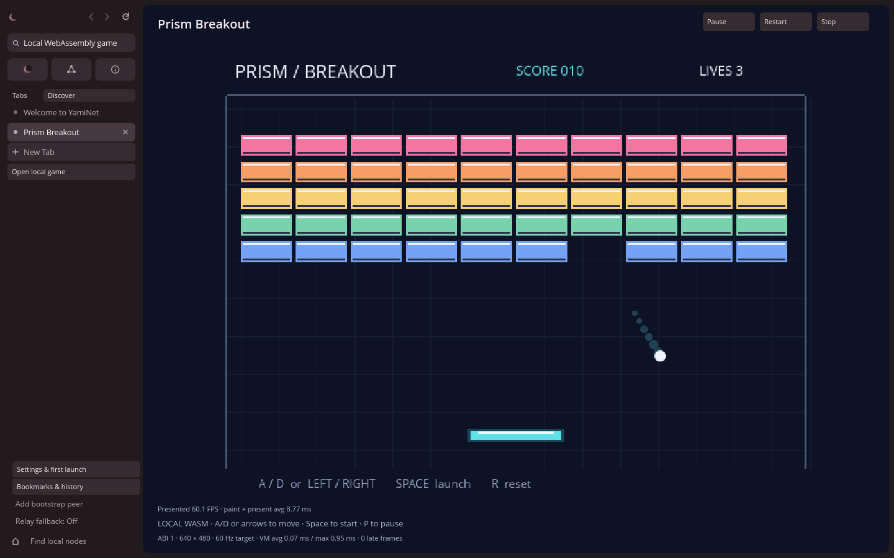

# Yami Games 0.1

Current presentation: [Games 0.1.1 polish and validation](games-0.1.1.md).

This milestone adds explicitly opened local WebAssembly games to the native
winit/tiny-skia/softbuffer browser. YLang/YSL pages, Discover, full-text search,
YNP/TLS/DHT and the separate language server retain their document routes.

## Play

```sh
cargo run --release -p yami-browser -- --game games/breakout/game.yami-game.json
```

Alternatively, use **Open local game** and enter a local manifest path. The
manifest and its module remain inert when encountered as YLang content or a
network response. There is no remote game loader, association-based autolaunch,
installed-game registry or automatic execution on browser startup.

Space starts Prism Breakout; a second Space launches the ball. A/D or arrows
move the paddle. Space serves after a lost life. Destroy all 50 bricks for 500
points; three lost balls end the game. Space restarts from the end screen.
P/Escape pauses/resumes, R resets. Native Pause/Resume, Restart and Stop controls
remain outside the guest canvas. Stop releases the VM; Restart reloads it.
Switching tabs, losing focus or opening a browser panel pauses and releases keys.
Returning to a tab requires explicit resume. Ctrl+L/T/W and other browser
shortcuts remain available. Game paths are not persisted as browsing history,
bookmarks or a homepage.

## Runtime choice and threat boundary

Wasmi **2.0.0** is pinned in Cargo.toml and Cargo.lock. Its declared Rust minimum
is 1.86; the host and guest build with YamiNet's pinned **Rust 1.90.0**. Wasmi is a
maintained interpreter with instruction fuel and store resource limiters. Its
smaller interpreter integration is suitable for this limited 2D milestone.
Wasmtime offers a mature optimizing JIT and epoch interruption but adds a larger
compiler integration and version-dependent toolchain requirements. The ABI does
not depend on Wasmi, so a future backend can be evaluated without rewriting games.

Modules are untrusted executable content. The only linked host functions are the
four drawing imports below. Unknown imports, imported memories, WASI, OS,
filesystem, process, networking, clocks and host pointers are unavailable. Binary
validation, eager translation and Wasmi's strict compilation-shape limits are
always enabled; unchecked module loading and precompiled native artifacts are
not supported. Initialization, optional module start, ABI negotiation and init
share one fuel budget. Input and update share one budget per frame. Reset has its
own bounded budget. Exhaustion, traps and invalid drawing fail the game closed;
only a complete validated frame replaces the last visible frame.

| Resource | Limit per session |
| --- | --- |
| Manifest | 4 KiB, schema and ABI version 1, unknown fields rejected |
| Binary module | 1 MiB, binary Wasm version 1 only |
| Guest linear memory | One memory, 4 MiB including growth |
| Tables | One table, 1,024 elements including growth |
| Instances | One |
| Call/value stack | 128 recursive calls / 64 KiB interpreter value stack |
| Fuel | 200,000 per initialization, reset, or input+update |
| Drawing | 512 commands per frame |
| Drawing area | 614,400 pixel visits per frame (clear/rect/circle bounding areas) |
| Text | 128 UTF-8 bytes per command; 4,096 bytes per frame; sizes 8–48 |
| Logical canvas | 640×480, integer coordinates and bounded positive dimensions |
| Concurrent workers | Four across the browser process; browser tab limit also applies |

A reference must be a relative local path without `..`, absolute paths, URI
schemes or Windows separators. Canonical module paths must remain inside the
manifest directory, including symlink resolution. Reads are bounded and regular
files are required. File loading and module translation also run off the UI
thread. An administrator racing filesystem changes is outside this local-path
check's threat model; it is not an OS filesystem sandbox.

A fuel unit is an interpreter cost, not a wall-clock deadline. Loading and
translation are bounded by module size/shape but are not fuel-metered or forcibly
interruptible. Dropping a tab signals its worker without joining on the UI
thread; the worker frees its VM after the current bounded guest call or load
finishes. Workers have no native OS capability imports. They still share the
browser process and runtime implementation: runtime vulnerabilities, allocator
failure or host bugs can affect that process. This is experimental containment,
**not a claim of production-grade sandbox security**. Process isolation and
independent security review remain future work.

## ABI 1

The namespace `yami_game_v1` is immutable. All ABI scalar parameters are Wasm
`i32`; colors are bits in `0xRRGGBBAA` order. The Rust guest helpers are in
`games/yami-game-api`. A guest exports:

| Export | Signature | Contract |
| --- | --- | --- |
| `yami_game_abi` | `() -> i32` | Must return 1 |
| `yami_game_init` | `() -> ()` | Initialize state; no drawing |
| `yami_game_input` | `(held, pressed) -> ()` | Set input; no drawing |
| `yami_game_update` | `(dt_us) -> ()` | Advance and emit a complete frame |
| `yami_game_reset` | `() -> ()` | Restore initial state; no drawing |

Input masks: bit 0 left, bit 1 right, bit 2 start/action, bit 3 reset. `pressed`
contains rising edges accumulated since the last update, including short taps;
key autorepeat does not create extra presses. Unknown bits are masked. Alternate
physical keys for the same action can be held together. Pause, focus changes and
browser controls clear held keys and pending presses. Pause prevents updates;
resume begins a fresh schedule without accumulated simulation time.

| Import | Signature | Contract |
| --- | --- | --- |
| `clear` | `(rgba)` | First command of every frame |
| `rect` | `(x, y, w, h, rgba)` | Positive rectangle entirely within canvas |
| `circle` | `(x, y, radius, rgba)` | Positive circle entirely within canvas |
| `text` | `(ptr, len, x, y, size, rgba)` | Copies bounded UTF-8 from exported `memory`; control characters rejected; alpha must be 255 |

The UI paints validated logical commands at the displayed physical resolution
into an isolated pixmap, using uniform scaling and letterboxing. Shaped text is
rasterized at that resolution too; overflow is clipped to the pixmap. Guest drawing cannot cover tabs, controls or other pages.
Neither the runtime nor the browser has Breakout-specific drawing or simulation.

Each worker advances at a target of 60 Hz with fixed `dt_us=16667`. A late frame
slows simulation; it does not create an unbounded catch-up queue. One latest-frame
mailbox, coalesced wake notifications and atomic input masks bound communication.
The UI never awaits a guest call or worker join. A paused worker sleeps on a
condition variable. A background game is paused, so active document navigation
continues independently. The first frame is published even if focus changed
while loading, so paused tabs retain a visible screen.

## Manifest

```json
{
  "version": 1,
  "abi": 1,
  "title": "My local game",
  "description": "An original game",
  "module": "game.wasm"
}
```

The current version defines one fixed logical canvas and no capabilities. Titles
and descriptions have length/control-character limits. Modules use original
geometric graphics and bundled browser fonts; no downloaded art or services are
required. The included game binary has its matching Rust source and independent
Cargo.lock checked in; rebuilding is documented in `games/README.md`.

## Future extension points

- **Authenticated YNP delivery:** add a separate, explicitly authorized package
  acquisition layer returning verified bounded bytes. An authenticated publisher
  is still untrusted code; document loading must never execute a module.
- **Sprites/textures:** introduce bounded package resources and numeric resource
  handles with decoded-size limits. Extend command validation and the renderer.
- **Audio:** a separately granted capability with bounded sample buffers and an
  independent output worker; no device access from guest code.
- **Mouse/controller:** add a versioned input structure; browser capture/focus
  policy remains in the native adapter.
- **GPU:** implement a renderer backend consuming validated frames. GPU resource
  allocation and command limits need separate budgets.
- **Publishing/Discover:** introduce an explicit executable package content type,
  publication verification and user launch action, distinct from YLang Pages.

These interfaces are design boundaries only. No hosted loader, sprite decoder,
audio, mouse/controller gameplay, GPU backend, publishing endpoint or game
Discover integration is implemented in 0.1.

## Validation and performance

Validation ran on Linux x86_64 with Rust 1.90.0, an Intel Xeon Platinum 8573C
host, three visible CPUs and a cgroup quota of two CPU cores. The game binary
was rebuilt from its formatted source with the locked guest dependencies.

```sh
cargo fmt --all -- --check
cargo clippy --workspace --all-targets --locked -- -D warnings
cargo test --workspace --locked
cargo test --locked --manifest-path tools/yami-lsp/Cargo.toml
python3 -m unittest discover -s packaging -p 'test_*.py' -v
cargo run --release --locked -p yami-games --example measure -- games/breakout/game.yami-game.json
cargo test --release --locked -p yami-browser --bin yami-browser measure_native_game_rendering -- --ignored --nocapture
xvfb-run -a -s '-screen 0 1440x900x24 -nolisten tcp' python3 scripts/test-games-x11.py --browser target/release/yami-browser --output work/game-x11
```

Final checks: **333 workspace tests passed**, with nine intentional skips
(including the manual rendering benchmark); **57 language-server tests passed**;
**six package regression tests passed**. Workspace formatting and Clippy with
warnings denied passed. The manual release rendering benchmark and the native
X11 game lifecycle test were run separately and passed.

The runtime tests exercise binary/manifest rejection, unsupported ABI versions,
missing/unknown imports and exports, denied WASI, module byte limits, initial
memory/table limits, growth, out-of-bounds memory, recursive calls, loops and
traps in start/init/input/update/reset, invalid coordinates and dimensions,
command/overdraw budgets, text length/pointers/UTF-8/control characters, input
edges, pause/resume, independent VMs, worker admission and closing during loading.
The checked-in Rust/Wasm game is exercised for screens, paddle motion, collision
and scoring, lives, game over and reset. Browser tests cover modal keyboard
ownership, tab isolation, pause/stop/restart, closing while documents survive and
clipping a guest frame to its viewport.

The X11 script uses an isolated profile and peer directory with local-only
networking. It passed CLI and UI manifest loading, native XTEST keyboard play,
byte-identical paused frames, resume, browser shortcuts and YLang navigation,
background pause, closing a game tab, stop/restart, 900×600 scaling and clean
window shutdown with a game still open. Screenshots are actual native softbuffer
window captures. Physical keyboards, controllers, Windows and hardware display
presentation were **not** tested in this environment.

| Measurement (release build) | Result |
| --- | --- |
| VM load/validation/instantiation | 1.853 ms |
| 10,000 mixed gameplay/screen updates, no pacing | mean 0.0337 ms; p50 0.0187; p95 0.0825; p99 0.2316; max 2.1468 ms |
| Actual native window capture at 1440×900 | 60.1 new game frames/s; paint + present mean 8.77 ms; VM mean 0.07 ms; zero late worker frames in this capture |
| Largest emitted sample frame | 195 commands (limit 512) |
| Native 1440×900 composition, 180 gameplay frames | mean 7.986 ms; p50 7.384; p95 11.696; max 20.489 ms |

The VM benchmark excludes rendering, scheduling and presentation. The composition
benchmark includes browser chrome, text, game drawing and scaling but excludes
softbuffer presentation. The on-screen HUD separately measures presented *new*
game frames, paint plus present time, VM time and late worker frames. It does
not count repainting the same game frame as new gameplay. Paused periods are
excluded from presentation intervals. These are local diagnostics, not telemetry.

Profiling initially measured roughly 31 ms of composition and 29 FPS. Solid
browser surfaces were taking the gradient shader path; painting equal-color
surfaces with a solid shader reduced the composition budget above. CPU-heavy
concurrent compilation produced lower rates, so performance runs were repeated
without builds competing for the two-core quota. Debug builds are substantially
slower; use `--release` for playing. Software rasterization, window size, scaling,
text shaping, X11/compositor behavior and CPU contention remain performance
limits. This milestone targets 60 Hz; it does not guarantee 60 FPS or hard
real-time deadlines on every machine.


