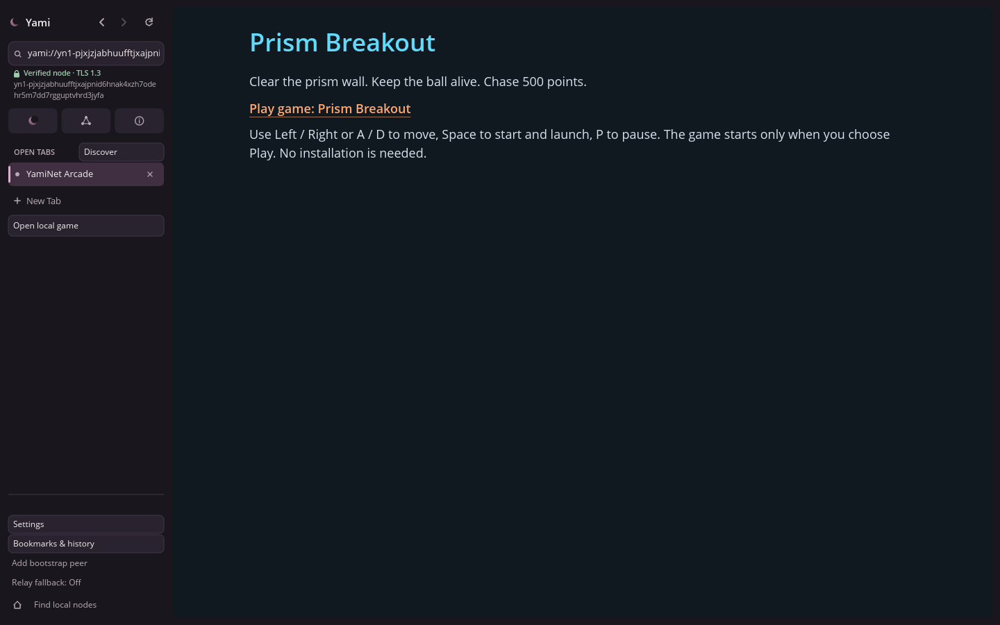
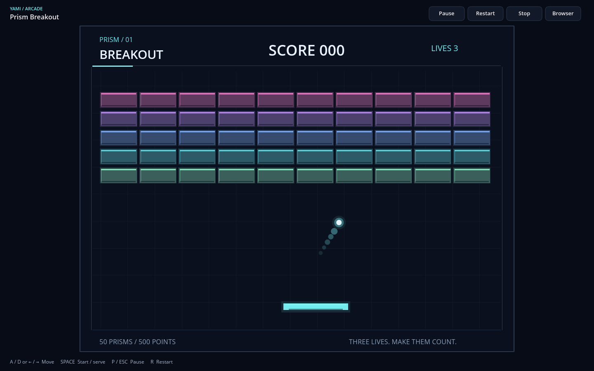

# YamiNet Games 0.2 — instant play

An authenticated YamiNet website can now offer **Play game: Prism Breakout**.
Choosing Play fetches its manifest and Wasm from the publisher's own node into
memory, validates integrity, and opens the existing native game surface in an
ordinary Yami Browser tab. Players do not choose files, install anything or run
an external launcher. Ordinary YLang navigation never executes remote code.
Local games and the immersive toolbar, keyboard controls, pause/resume, focus
handling and tab navigation remain available.

## Publish on your node

From the repository root, using Rust 1.90 or newer:

```sh
cargo build --locked -p yami-browser -p yami-node
cargo build --locked -p yami-games --example publish
mkdir -p work/arcade
cp sites/arcade/home.ylang sites/arcade/default.ysl work/arcade/
target/debug/examples/publish games/breakout/game.yami-game.json work/arcade prism
target/debug/yami-node site check work/arcade
target/debug/yami-node identity new --dir "$PWD/work/arcade-identity"
target/debug/yami-node serve-dir 127.0.0.1:7443 work/arcade \
  --identity "$PWD/work/arcade-identity" --tls --dht --dht-local \
  --dht-dir "$PWD/work/arcade-host-state"
```

Keep identity/state outside the site. The publication command runs only on the
publisher's computer and refuses existing output files. For deliberate updates,
remove the old publication in staging and prepare it again. `site build` includes
validated game manifests and their referenced modules, excluding unrelated files.
Page and game changes are read on each request without a node restart.

Configure a separate browser profile, replacing `NODE-ID` with the complete ID
printed by the node and using an absolute state directory:

```text
yaminet-config 1
role browser
network loopback
state /absolute/player-state
bootstrap NODE-ID@127.0.0.1:7443
```

Run `target/debug/yami-browser --config /absolute/browser.conf --desktop`,
navigate to **yami://NODE-ID/home**, and click **Play game: Prism Breakout**.
Space starts the game and launches the ball; A/D or arrows move; P pauses.
Browser restores the sidebar and pauses; Focus game returns to immersive mode
with explicit resume. Closing the game leaves the publisher page in its own tab.

`> game:prism | Prism Breakout` is the inert YLang 0.2 offering. It names only a
same-owner safe key. See the [wire/manifest specification](specs/v0.2/ynp-games.md)
for the format, resource support, exact bounds, consent boundary and limitations.
ABI 1 game drawing/text resources are embedded in Wasm; this milestone does not
invent external guest asset access. Ordinary website PNG resources still work.

## Reproduce the actual two-process demonstration

On Linux with an X11 display, `xdotool` and ImageMagick `import`:

```sh
python3 scripts/test-hosted-games-x11.py \
  --browser target/debug/yami-browser --node target/debug/yami-node \
  --publisher target/debug/examples/publish --output work/hosted-demo
# With Xvfb installed, prefix the command with:
# xvfb-run -s '-screen 0 1440x900x24'
```

The script creates a publisher site/identity and a separate empty player profile,
starts the real node process, starts the real native browser process, types the
node's actual `yami://` address, and activates Play using a synthetic mouse click.
Before Play it checks that only the document/DHT have been served. Afterwards it
checks the two authenticated game-resource replies, runs game controls, verifies
stable paused frames, opens document tabs, verifies background pause and source
page preservation, checks for player executable files, and cleanly exits both
processes. It records screenshots, logs, PIDs, the real address and a JSON report.
Test profiles and identities are removed afterwards; the recorded test address is
historical, not an available public service.

The checked-in [native-window report](evidence/hosted-games-x11.json) records an
actual passing run. These captures are from a virtual Linux X11 display using
XTEST input; they are not mockups or physical-display evidence.





## Verification and remaining work

Run `cargo fmt --all -- --check`, `cargo clippy --workspace --all-targets --locked -- -D warnings`
and `cargo test --workspace --locked`. The full workspace run passed **351 tests with nine intentional skips**; formatting
and Clippy with warnings denied passed. Both native-window scripts passed. A final
browser model/hosted-delivery rerun passed after making the delivery badge depend
on successful loading. The new tests cover versioned framing,
malformed/oversized/truncated resources, request/key/type mismatch, duplicate and
unknown manifest fields, hash/length mismatch, typed safe publication files,
plaintext refusal, wrong node and relay pins, failed TLS transfers, explicit
consent, direct and relayed delivery, controls, history, cancellation and worker
release. Existing runtime tests exercise import refusal, memory/table/stack
limits, fuel at every guest entry point and invalid drawing. The separate
`scripts/test-games-x11.py` exercises the original local CLI and native launcher.

Independent-machine and physical internet validation is still required. In
particular, test publisher and player on separate hosts/networks; public signed
DHT publication/lookup and endpoint changes; direct TLS through real firewalls;
outbound-only hosts behind NAT via a public relay; registration races under load;
slow/interrupted/high-latency transfers and deadline behavior across those paths.
Test Windows, physical keyboard/focus events, hardware displays and high-DPI
presentation separately. Same-machine process, TLS, relay and synthetic-input
checks do not establish those results.

The sandbox remains experimental: Wasmi executes on bounded game workers in the
browser process, with no guest filesystem, network or OS capabilities. This has
not received an independent security review, does not promise production-grade
sandbox security, and does not impose a hard wall-clock limit on Wasm compilation.
There is no game installer, marketplace, multiplayer or GPU backend.
