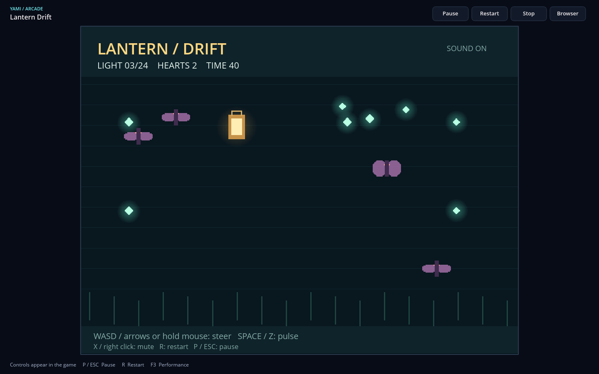

# YamiNet Games 0.3

Games 0.3 extends the existing Wasmi worker, native game tabs and authenticated
instant-play delivery. Lantern Drift is the second original game; Prism Breakout
and its checked-in ABI 1 binary remain unchanged. No WebView, script engine,
JavaScript, GPU renderer, marketplace or installer is involved.

## Play and publish

Local: open `games/lantern-drift/game.yami-game.json` using **Open local game**, or
pass its absolute path to `yami-browser --game`. The committed Wasm is ready to
play. WASD/arrows and held left mouse steer; Space/Z pulses; X/right click mutes.
Gather 24 lights in 50 seconds without losing three hearts to moths.

Publisher preparation (from the repository root, in a staging copy of the site):

```sh
cargo run --locked -p yami-games --example publish -- games/breakout/game.yami-game.json sites/arcade prism
cargo run --locked -p yami-games --example publish -- games/lantern-drift/game.yami-game.json sites/arcade lantern
cargo run --locked -p yami-node -- site check sites/arcade
```

Serve the directory with the existing pinned TLS identity and discovery setup
in [the arcade guide](../sites/arcade/README.md). The page contains
`> game:lantern | Lantern Drift`. Merely visiting it loads no game resources.
Choosing Play authenticates the publisher, fetches the manifest, module and all
assets, verifies them, then opens the native tab. Players install nothing and
provide no local file paths. Site checking/building validates and copies game
assets too. The publisher refuses implicit replacement of existing files.

On Linux, building the native browser requires `pkg-config` and the ALSA
development package (`libasound2-dev` on Debian/Ubuntu); deployed browsers use
`libasound.so.2`. Headless `yami-games` builds keep native audio optional.

## Formats and negotiation

Manifest versions 1/ABI 1 and 2/ABI 2 are accepted; other combinations fail.
Version 1 cannot declare external assets. Both formats reject unknown fields,
unsupported versions, oversized manifests, invalid titles, paths and URLs.
The module's `yami_game_abi() -> i32` must equal the manifest ABI. The remaining
exports retain ABI 1 signatures: init/reset `() -> ()`, input `(i32,i32) -> ()`,
update `(i32 dt_us) -> ()`. Legacy input still receives only the original four bits.

A version 2 local manifest adds `assets`, for example:

```json
{"version":2,"abi":2,"title":"Example","description":"A sprite game",
 "module":"example.wasm","assets":[
   {"id":0,"key":"sheet","kind":"png","bytes":123,"sha256":"64 lowercase hexadecimal digits"},
   {"id":1,"key":"chime","kind":"wav","bytes":456,"sha256":"64 lowercase hexadecimal digits"}
 ]}
```

Sizes and digests must match actual files; the example values are placeholders.
Local resources resolve to `sheet.png` and `chime.wav` inside the manifest
folder; canonical paths cannot escape through symlinks. The hosted form replaces
`module` with `{key,bytes,sha256}`. Assets use the same declarations. The publisher
assigns names such as `lantern-0` to avoid collisions with other games.

YNP v3 adds typed resources PNG=3 and WAV=4 to Manifest=1 and Module=2. Requests
still use strict resource keys, pinned TLS 1.3, the exact originating publisher
and relay pins. No redirects, URLs, cross-origin references or plaintext fallback
are available. All resources are loaded before execution, within the existing
8-second aggregate transfer deadline and a bounded aggregate byte budget.
SHA-256 integrity is relative to the authenticated publisher's manifest; it is
not a third-party endorsement of the game.

## ABI 2 imports

All arguments/results below are Wasm i32. ABI 1 drawing imports remain unchanged
in `yami_game_v1`. New imports live only in `yami_game_v2` and reject use before
negotiation or by ABI 1 guests:

| Import | Arguments | Result / behavior |
| --- | --- | --- |
| `input` | field | 0 held, 1 pressed, 2 released, 3 pointer X, 4 pointer Y |
| `sprite` | asset, sx, sy, sw, sh, x, y, w, h, layer | Draw source rectangle into destination |
| `audio` | op, channel, asset, value, looping | 0 play, 1 stop, 2 volume, 3 mute |

New input bits: Up=16, Down=32, Action=64, Secondary=128, left mouse=256,
right mouse=512. Existing bits remain Left=1, Right=2, Start=4, Reset=8.
Coordinates outside the surface are (-1,-1). UI mapping uses the same aspect
preserving surface as painting, after physical-to-logical DPI conversion.
Releases are forwarded even outside the game. Modals, tab changes, focus loss,
pausing and browser actions release held input. Browser shortcuts keep priority.

Sprite dimensions must be positive. Destination X is -640..1280 and Y is
-480..960; width ≤1280, height ≤960. Source rectangles must be inside the texture.
Layer -128..127 is sorted stably after the initial clear; primitives use layer 0.
Alpha uses premultiplied source-over compositing. Nearest sampling keeps sheet
frames isolated; an isolated destination pixmap clips all guest drawing at every
window size and DPI. The renderer borrows decoded textures and never decodes or
copies sheet crops per frame.

Audio channels are 0..7, volume 0..1000, looping 0/1. Mute uses value 0/1.
A play replaces the channel; stop drops it. Commands commit only after a valid
frame. Background loops and effects share immutable decoded samples. Pause/resume
controls native sinks; reset clears them; stop/failure/close drops the output
stream and channels. A 16-source admission bound also caps the native mixer queue
if a device stalls; excess plays remain silent until sources are released.
Unavailable output is silent and does not fail game execution.
There is no microphone API, device enumeration API or direct native audio handle
in the guest. See [SDK examples](../games/yami-game-api/README.md).

## Bounds and isolation

- 16 declared resources per game; unique IDs 0..15 and typed keys.
- 4 MiB total encoded assets, 16 MiB total decoded textures/audio per session.
- PNG: 256 KiB encoded, dimension ≤2048, ≤1,048,576 pixels, ≤4 MiB decoded.
  Static PNG only; malformed, truncated and animated files fail closed.
- WAV: 1 MiB encoded, signed PCM16 mono/stereo, 8–48 kHz, ≤10 seconds.
- Module 1 MiB; Wasm memory 4 MiB; 200,000 fuel per tick/entry budget;
  stack/recursion/table and four concurrent worker limits remain unchanged.
- 512 drawing commands, twice the canvas pixel area and 4096 text bytes per frame;
  clipped sprite area counts toward the drawing budget; 32 audio commands/tick.
- No WASI, guest filesystem, network, clock, OS handles or arbitrary imports.

Decoding and eager Wasm compilation run on admitted workers, never the UI thread.
The latest-frame mailbox remains bounded. Decoded assets live for the session,
are shared by frames and are released from terminal snapshots; no global texture
cache accumulates across stopped tabs. Native drawing remains software based.

## Validation

See [the validation record](evidence/games-03-validation.md) for actual commands,
results, screenshots, measurements and physical testing limitations.


