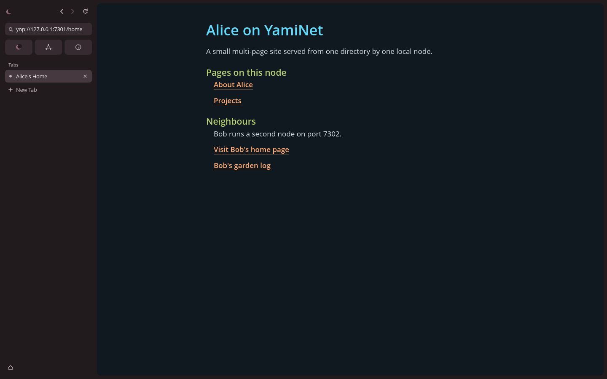
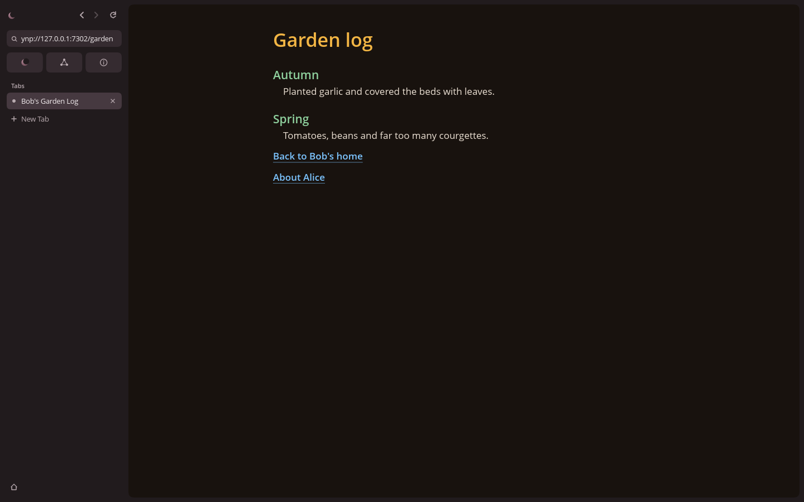

# Creating and publishing a YamiNet site

**EXPERIMENTAL: plaintext, unauthenticated, localhost only. Not secure for
sensitive use.** "Publishing" here means serving a directory from a node on
your own machine. Nothing is reachable from other computers.

A YamiNet site is a directory of YLang pages plus one shared YSL stylesheet.
`yami-node serve-dir` serves every page in that directory over YNP.

## 1. Lay out the directory

```text
sites/
  alice/
    home.ylang
    about.ylang
    projects.ylang
    default.ysl
```

| File | Becomes |
| --- | --- |
| `<key>.ylang` | The page `ynp://<address>/<key>` |
| `default.ysl` | The stylesheet sent with every page of the site (optional) |

A page key is 1 to 128 ASCII letters, digits, `_` or `-`, exactly as in the
[YNP draft](specs/v0.1/ynp.md). The file name must match the key exactly,
including letter case, even on case-insensitive file systems. Other files,
subdirectories, symlinks and names such as `con` or `com1` are never served.
Without `default.ysl` the browser uses its built-in default style.

## 2. Write pages

Pages use the unchanged [YLang 0.1](specs/v0.1/ylang.md) syntax:

```text
@page 0.1
  title Alice's Home
  language en

= Alice on YamiNet
A small multi-page site served from one directory by one local node.
:: Pages on this node
  > ynp://127.0.0.1:7301/about | About Alice
:: Neighbours
  > ynp://127.0.0.1:7302/home | Visit Bob's home page
```

Links are always absolute `ynp://` addresses. Use the node's own address to
link within the site, and another node's address to link across sites. The
browser fetches a linked page only when the reader opens it.

Check a page before publishing it; parse errors include line and column:

```sh
cargo run -p yami-browser -- --terminal sites/alice/home.ylang --style sites/alice/default.ysl
```

## 3. Serve it

```sh
cargo run -p yami-node -- serve-dir 127.0.0.1:7301 sites/alice
```

The node lists the page addresses it found and logs each request. The address
must be a numeric loopback IP (`127.0.0.1` or `[::1]`); anything else is
refused. Port `0` picks a free port and prints it. `--workers N` (1 to 32,
default 4) sets how many connections are handled at once; further clients wait
in the operating system's queue. Stop the node with Ctrl-C.

Open the site in the desktop browser, or fetch a page's source:

```sh
cargo run -p yami-browser -- --desktop ynp://127.0.0.1:7301/home
cargo run -p yami-node -- fetch 127.0.0.1:7301 about
```

## 4. Update it

The node reads the page and `default.ysl` again on every request, so edits,
new pages and deletions take effect without a restart: save the file and press
Reload in the browser. A page that is half-written at the moment of a request
may fail to parse; Reload again, or save through a temporary file and rename it.

## 5. Sign it (optional)

A node identity lets readers check that a site's files are exactly what you
published. Create an identity once, then sign the site after every change:

```sh
cargo run -p yami-node -- identity new
cargo run -p yami-node -- identity sign-site sites/alice
```

This writes `sites/alice/site.sig`, which covers every page and `default.ysl`.
Someone with a copy of the directory checks it against the node ID you gave
them yourself:

```sh
cargo run -p yami-node -- identity verify-site sites/alice yn1-...
```

Any edited, added or removed page makes verification fail until you sign again.
`serve-dir ... --identity <identity-directory>` prints the node's ID at startup
and reports whether `site.sig` still matches. Signing does not encrypt the site
or hide who published it, and the browser does not check signatures yet. See
[node identity](specs/v0.1/identity.md) for the format and limitations. Never
copy `node.key` into a site directory or repository.

To serve the site over encrypted, authenticated TLS 1.3 instead, add `--tls`.
Readers then use the printed `ynps://<node-id>@<address>/<key>` URLs, and a
fetch succeeds only from the node holding that ID's key:

```sh
cargo run -p yami-node -- serve-dir 127.0.0.1:7443 sites/alice --identity <identity-directory> --tls
cargo run -p yami-node -- fetch ynps://yn1-...@127.0.0.1:7443/home
```

Links inside pages stay `ynp://` addresses and the browser does not open
`ynps://` URLs yet. See [YNP over TLS](specs/v0.1/ynp-tls.md).

## Two sample sites

The repository includes two linked sample sites. Run each node in its own
terminal:

```sh
cargo run -p yami-node -- serve-dir 127.0.0.1:7301 sites/alice
```

```sh
cargo run -p yami-node -- serve-dir 127.0.0.1:7302 sites/bob
```

Then open either home page and follow links between the two nodes:

```sh
cargo run -p yami-browser -- --desktop ynp://127.0.0.1:7301/home
```

`sites/alice` also contains `welcome`, so the browser's pinned node tile
(`ynp://127.0.0.1:7301/welcome`) opens a page on Alice's node.





To regenerate these screenshots, which serve both samples on ports 7301 and
7302 and follow rendered links across the nodes:

```sh
cargo test -p yami-browser --bin yami-browser -- --ignored capture_sites
```

The images are written to `target/screenshots/`.

## What the node will and will not serve

- Only `<root>/<key>.ylang` files whose canonical path is exactly inside the
  site root under that name, and `<root>/default.ysl`.
- Keys with `/`, `\`, `.`, `:`, `%`, spaces, non-ASCII or control bytes are
  rejected by the YNP decoder before the file system is touched.
- Symlinks that point outside the site or to another name, directories, and
  non-regular files are refused, as are files over the YNP limits (256 KiB per
  page, 16 KiB of style) or with invalid UTF-8. The connection is closed and the
  reason is logged on the node.
- A missing page gets a YNP NotFound reply.
- A leading UTF-8 byte-order mark is removed; otherwise files are sent as is.

Anyone who can write to the site directory controls what it serves, including
through hard links. Keep the directory private to you.
